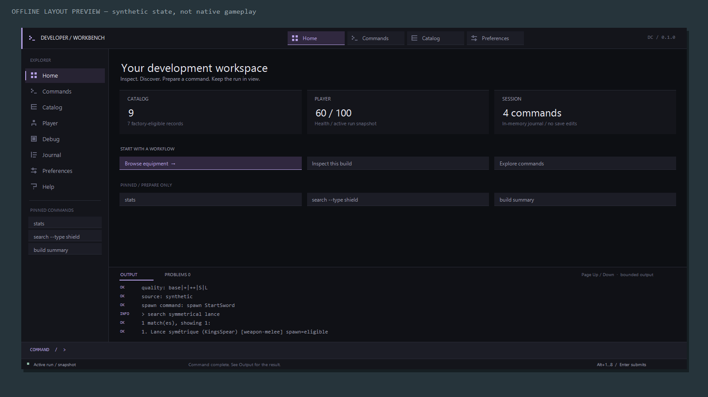

# DC-M4.1 — Fancy redesign / developer workbench overhaul

**Milestone:** DC-M4.1, directly following DC-M4; no numbering conflict found.

**Starting checkpoint:** `198c03e`, clean working tree.

**Version:** 0.1.0-alpha; assembly/mod remains 0.1.0.

**Target:** Dead Cells v35 / DCCM 35.13.8 / .NET 10.

**Status:** offline-complete candidate; native interaction and director UI approval pending.

**Post-checkpoint update:** R9 subsequently reached gameplay and exposed a native
see-through/misplaced-background defect. The current R10 correction and remaining
native retest are documented in [the fix report](DC-M4.1_OPAQUE_FIX.md). Artifact
hashes and unlaunched statements below describe the original checkpoint.

**Scope:** local implementation, validation, artifacts, fresh fixture and checkpoint.

## 1. Product decision and visual transformation

Fancy was redesigned **in place**, rather than introducing a fifth presentation.
`ui fancy` and existing configuration retain compatibility. `ui workbench` names
the same flagship presentation; startup config normalizes that alias to `fancy`.
Classic remains the default/fallback, Compact remains the small overlay, and
Inspector remains the read-only diagnostic rail.

The old iron/brass framing is replaced by an original modern desktop-tool shell:

- near-black base, soft panel contrast, fine separators and restrained violet;
- original geometric tool icons and top section navigation;
- left Explorer with active/hover states and pinned command preparations;
- central section-specific tools and structured rows/cards;
- independently selectable Output and Problems dock;
- anchored native command input and status footer;
- Appearance/Behavior preferences with visible selection and draft state.

The user-supplied desktop-app references guided layout, hierarchy, separation and
visual confidence. No reference branding, art, terminology or workflows were
copied. There are no game textures, ornamental fantasy details, external font
payloads or shader dependencies. Runtime fonts are game-provided; desktop fonts
in offline previews approximate those metrics.

## 2. Implemented tool surfaces

| Section | Implemented interaction |
|---|---|
| Home | Catalog/player/session cards, workflow navigation, pinned preparations |
| Commands | Complete paged registry, category filters, usage/descriptions/safety labels, Prepare/Help |
| Catalog | Editable prepared search, type filters, complete result paging, display names/live IDs, selection, level/quality builder and detail preparation |
| Player | Health/native allocation snapshot, build inspection, heal/scroll preparations |
| Debug | Target build/runtime information, catalog source, biome, snapshot/mod-list preparations |
| Journal | Paged commands, all pins, recent successful spawn summaries and explicit spawn-last preparation |
| Preferences | Appearance/Behavior groups; accent/density/scale/retention/completion/startup layout; draft/apply/save/revert/defaults |
| Help | Navigation, natural-name examples, pins, scroll controls and help preparations |

Click Explorer/top navigation, use `Alt+1…8`, or open a section with
`workbench <section>`. The command input remains accessible in every section.
Suggestions appear above it across all sections. A moving three-row candidate
window keeps high-index/reverse selections visible without overlapping output.
Output/Problems provide severity markers, multiline failures and independent
scroll state for problems. Failure details retain no raw exception object.

### Equipment workflow

`browse assault shield` uses the shared catalog index. The search field prepares
that command for native-input editing; Clear resets the query. Filters and page
actions reach every returned row, including the lower row count at 720p. Queries
and recent searches are bounded. A 300-row result ceiling is visibly indicated.

Selection shows an English/current display name paired with the canonical ID.
Larger viewports also show the current-language name, registered aliases and
item-detail preparation. The builder chooses native/default level or 1–99 and
Auto/base/+/++/S/L quality. Unknown legendary support and nonspawnable rows cannot
prepare a spawn. **Prepare spawn only inserts text.** Explicit Enter runs the
existing resolver/factory/forge handler, with all native validation preserved.

At smaller desktop sizes details reduce to name/ID/eligibility/Prepare; named
level/quality options remain available through command input. No separate spawn,
health or scroll implementation was introduced.

### Session tools and commands

Four new canonical UI/config commands bring the live registry to **34**:
`workbench` (alias `desk`), `browse`, `pin`, and `unpin`. Pins validate a registered
command name and are bounded to twelve. The first three appear in Home/Explorer;
Journal reaches every pin. Selecting a command, pin, history row or completion
only prepares input. Existing read-only `repeat` and explicit mutating `spawn
last` semantics are preserved.

The UI exposes forty recent command lines and ten failures from the existing
bounded 100/20 command/error journal. Recent spawns retain twenty summaries with
display names and IDs. Up to eight recent catalog queries are session-only.
No journals/pins/searches are written into config or save files.

## 3. Preferences and compatibility

Appearance supplies violet/blue/sage accents, comfortable/dense row spacing and
85%/100%/115% scale choices. Behavior supplies 100/200/500 output lines,
suggestion/Tab toggles and startup mode. Text configuration retains its broader
validated ranges and existing settings. Old config files use defaults for new
`Accent`/`Density` fields.

Preference changes are a draft. Accent previews within Preferences; Apply session
activates the draft for the current process. Save writes only the mod's own
`console-config.json` using the existing sibling-temp/atomic-replace strategy,
then applies on success. A failed Save retains both the previous file and active
settings. Revert restores active values; Defaults changes only the draft.
Startup mode takes effect on next load or explicit config reload, leaving the
current section open during Apply/Save.

Workbench deliberately uses 86% scene height and bounded 72–94% width. `consize`
reports this exception while retaining Classic/Inspector sizing. Compact keeps
its cap. Effective text/input scale adapts to viewport size. Below 960×600 scene
units the workbench projects Classic rather than unusably small controls.

Natural names, canonical IDs, aliases, structured ambiguity, non-executing fuzzy
discovery, multiword spawn options, ss/as/rs, player/debug/help/config/version and
legacy transplant/cohesive input placement remain. The native inventory-backed
scroll service was not changed. Save/resume remains unverified.

## 4. Engineering and interaction ownership

- `WorkbenchState` is the session controller. Explicit events capture immutable
  catalog metadata and hero/biome diagnostics; no per-frame CDB/localization poll.
- `WorkbenchPresentation` produces original surfaces, captions, hit regions and
  effective native-input placement/scale. The SVG generator consumes the same plan.
- `WorkbenchEffect` returns input/config effects. The click controller has no
  gameplay context or execution callback. Native Enter is the submission path.
- `WorkbenchUiCommands` integrates section/search/pin commands with the registry.
- `DevPanel` reuses pooled h2d primitives/colors. Growth brings existing labels
  and input above new surfaces; input positioning follows the actual plan scale.
- Foreground/open-only Win32 pointer/client reads supply hit testing and hover.
  Mouse and Alt-section key edges share the existing Boot.update pump. Held keys
  across focus/visibility reset are suppressed. No extra hooks/input injection.
- Config save is fixed to the already-owned mod directory. No filesystem browser,
  shell execution, networking or arbitrary external-process facility was added.

## 5. Offline visual evidence

[15-view gallery](previews/DC-M4.1/index.html): Home, Commands, Catalog, Player,
Debug, Journal, Preferences, Help, Behavior preferences, unsaved blue-accent draft,
completion, an actual mocked ambiguity result, 720p Catalog, Pins and Recent.
All have SVG and PNG projections. Reviewed Home/Commands/Catalog/Preferences,
Player, completion and Problems for hierarchy, spacing, legibility and separation.
The previous Fancy and four-mode gallery remain under `previews/DC-M4/` for
comparison; no prior preview/fixture evidence was overwritten.

These are synthetic offline views of implemented code, **not native gameplay
captures**. Browser/GDI fonts do not establish the installed game's glyph coverage,
actual text widths, focus, cursor visibility, layering or GPU timing.

## 6. Qualification

| Gate | Outcome / scope |
|---|---|
| Release build | Pass, zero warnings/errors |
| Debug build | Pass, zero warnings/errors |
| Offline suite | **780 checks, zero failures**; inherited 328 retained |
| Installed-English contracts | Two additional passes (782 total); 598 unique installed identities; no dataset copied |
| Workbench geometry | Eight sections × four resolutions × three scales × two densities, bounds and nonoverlapping control regions |
| Controller/command contracts | Canonical preparation, explicit dispatch, no click mutation, unsupported/legendary rejection, pin/query bounds, section aliases |
| Preference contracts | Draft isolation/revert/defaults, normalization, mod-config round-trip, failed write preserves prior bytes |
| Reachability | Every catalog/command result reachable by paging, including 720p; selected completion remains visible |
| Visual artifacts | Fifteen well-formed SVGs and fifteen original PNGs; historical comparison retained |
| Synthetic installer | Twelve checks, zero failures; process exit 0; expected refusal stderr retained separately |
| Runner outcomes | Seven checks, zero failures; clean exit remains unverified gameplay |
| Negative authorization | Missing switch, synthetic and malformed receipts refused; no game process |
| R9 fixture admission | VerifyOnly pass, zero failures, build identity matches, external denylist enabled |
| Standalone/reference audit | Only .NET/Microsoft.CSharp plus supported DCCM/game/Haxe/Hashlink/Serilog references |
| Privacy and source hygiene | External-denylist source/export scans, binary path/string checks, exact original-image allowlist |
| Reproducible package | Fixed timestamps/order; two builds produce the identical ZIP; entry checksums verified |

Local raw outputs are under `dist/DC-M4.1/`. An initial installed-English command
supplied a file instead of the required game root; the corrected root invocation
passes both file contracts. The diagnostic log is retained. Synthetic installer
refusal cases emit expected stderr; the final suite's process exit is recorded
directly. No check was removed to obtain a pass.

## 7. Artifacts and fixture identity

- ZIP: `dist/DC-M4.1/DeveloperConsole-0.1.0-alpha.zip`.
- ZIP identity: adjacent `.sha256` sidecar; not embedded here to avoid a
  self-referential package hash. `SHA256SUMS.txt` covers package contents.
- Fresh public source: `dist/DC-M4.1/public-source/`, single-commit export,
  no inherited development history or remote.
- Disposable fixture: `<fixture root>/DC-M2-R9`, copied from isolated R8.
- DLL SHA-256: `E90D6E2FEC9059FEA816C1D7E8BC423877952A8B5FEB0F0859541BAD55FA4426`.
- PDB SHA-256: `3781CC5EE50DB7C7B262E393845AF30B9F52628D547F352EA4B4F0A9F03099DB`.
- modinfo SHA-256: `3A84598DF4A7AD39F4D3786422A3F767298562DDB109A95B64E012196CADFEBF`.

R1–R8 are preserved. R6/R7/R8 DLL/PDB/manifest identities were checked before
and after; the old DC-M4 archive identity remains unchanged. R9 has only the
console and stock loader, isolated empty saves/data/config roots, pinned loader/
hlboot and fixture-local startup configuration. This establishes file admission,
not successful boot. R9 has no real authorization receipt and has not been launched.

The public ZIP contains only this mod's DLL/modinfo, public docs and original
previews. No PDB, framework/game binary, save, localization database, fixture
evidence or private dataset is included. The private research repository was not
needed or modified. No production installation, saves or Steam Cloud were changed.

## 8. Exact remaining manual request

Future authorization must explicitly match **R9 and the DLL hash above**, with
a bounded manual gameplay session, fixture-only saves and local evidence. A
longer or resumed session needs matching scope/authorization; R6 authorization
does not carry forward. No receipt has been created or launch permission inferred.

Execute R01–R20/H01, scroll controls A–F, M4-01…M4-06 and the new
**M4.1-01…M4.1-08** in [runtime verification](RUNTIME_VERIFICATION.md). Priorities:
native font metrics/layering, pointer capture/visibility and DPI mapping, Alt/Tab/
history/native input lock, every section/tool, preferences apply/save/reload/failure,
resize/transition/teardown/fallback, and retained GetText/spawn/scroll/save-resume
behavior. Offline contracts cannot settle these native questions.

Director UI acceptance, native testing and public release approval remain pending.
This milestone created a local checkpoint and fresh artifacts only. No game was
launched, no remote configured, and nothing pushed, uploaded or published.
